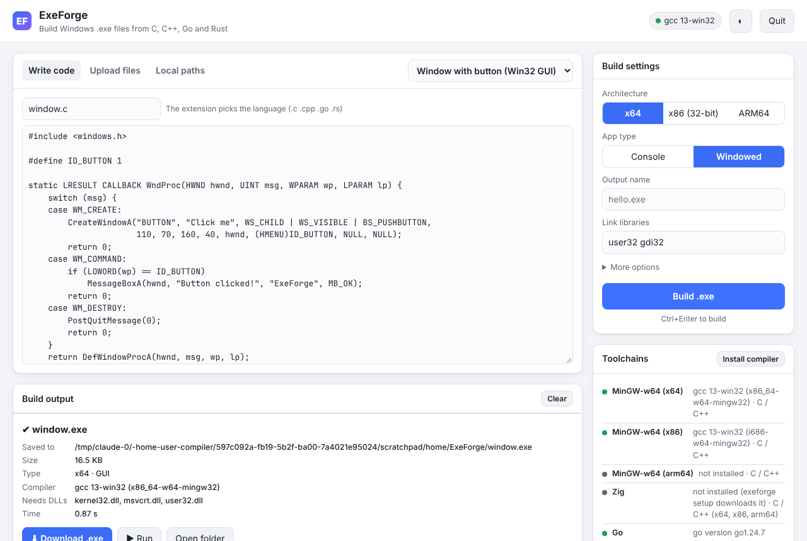

# ExeForge

**Build Windows `.exe` files on Linux** (and on Windows) from C, C++, Go and Rust.
ExeForge is one self-contained program with a command line and a graphical interface.



## Quick start

### Linux

```bash
chmod +x bin/exeforge-linux
./bin/exeforge-linux install        # copies to ~/.local/bin and adds "ExeForge" to the app menu
exeforge doctor                     # shows which compilers are available
```

If no compiler is found, pick one:

```bash
sudo apt install mingw-w64          # Debian/Ubuntu (Fedora: sudo dnf install mingw64-gcc mingw32-gcc)
```

```bash
exeforge setup                      # or: download the Zig cross-compiler (~50 MB, no root needed)
```

### Windows

Double-click `bin/exeforge-windows.exe`. The GUI opens in your browser. If no compiler is
installed, click **Install compiler** and ExeForge downloads Zig for you. The same `.exe` also
works as a command-line tool: `exeforge-windows.exe build hello.c`.

## Graphical interface

```bash
exeforge gui
```

This opens a local page (127.0.0.1 only, protected by a random token) where you can:

- write code in the editor or start from a template (console app, C++, a Win32 message box, a window with a button, Go)
- upload a set of source files, or point at files on disk
- choose x64, x86 or ARM64, and console or windowed
- set libraries, an icon, the product name and version, defines and extra flags
- download the resulting `.exe`, open its folder, or run it (through Wine on Linux)

## Command line

```bash
exeforge new console-c                         # creates hello.c
exeforge build hello.c                         # → hello.exe (x64, console, static)
exeforge build -a x86 tool.cpp                 # 32-bit
exeforge build -w -l user32 -l gdi32 app.c --icon app.ico --name "My App" --version 1.2.0
exeforge build main.c util.c -o dist/prog.exe -- -std=c11 -Wall
exeforge build ./my-go-package                 # Go (needs Go installed)
exeforge build main.rs                         # Rust (needs: rustup target add x86_64-pc-windows-gnu)
exeforge info prog.exe                         # arch, console/GUI, DLL imports
exeforge run prog.exe                          # runs it with Wine on Linux
```

Run `exeforge help` to see every option.

## How it works

| Language | Compiler used |
|---|---|
| C / C++ | MinGW-w64 gcc if installed, otherwise Zig (`zig cc -target x86_64-windows-gnu`) |
| Go | `GOOS=windows go build` |
| Rust | `rustc --target x86_64-pc-windows-gnu` |

C and C++ programs are linked statically, so the `.exe` only needs DLLs that ship with Windows.
Icons and version info are compiled from a generated `.rc` resource script.
Zig is downloaded from ziglang.org, checked against a pinned SHA-256, and stored in your user
cache folder (`~/.cache/exeforge` or `%LOCALAPPDATA%\exeforge`).

## Building ExeForge itself

You need Go 1.22 or later:

```bash
scripts/build-release.sh    # → dist/exeforge-{linux,windows,darwin}-{amd64,arm64}
go test ./...
```

On every push, CI cross-compiles sample exes on Linux and runs them on a real Windows runner.
It also checks that the Windows build of ExeForge can compile and run an exe by itself.
